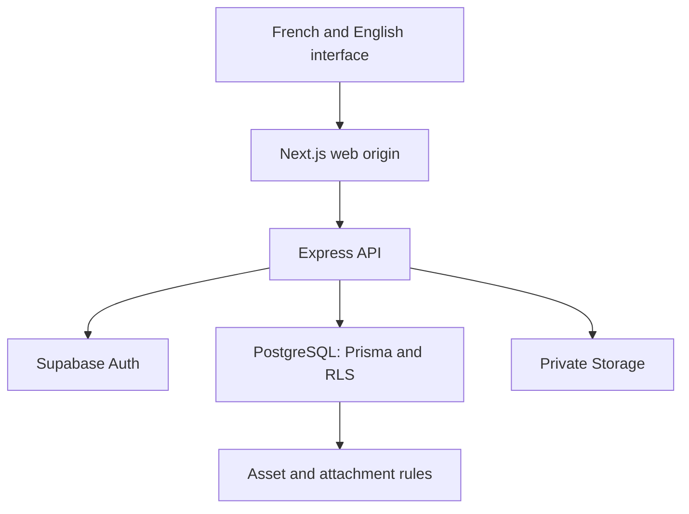

# Architecture

Lumavok has one browser-facing origin. Next.js serves the interface and forwards `/api/v1/*` to the private Express API. The API verifies Supabase Auth sessions, loads application permissions and queries PostgreSQL through Prisma. Browsers do not query application tables through the Supabase Data API.

## Accounts and ownership

A `user` is an application account linked to a managed `auth.users` UUID. Existing CUID identifiers remain intact. New accounts start with `USER`; client inputs and editable Auth metadata cannot assign authority. The API reloads roles and active seller relationships from the database.

The model `property_developer` represents a seller’s business profile. It does not represent a software developer. Sellers own their listings, assets, appointments and notifications. Applications start pending; administrators activate approved profiles and update account authority in a transaction. Administrators have a separate workspace and do not automatically act as sellers.

Every Prisma operation uses a transaction-local actor context on a restricted, non-owner connection. SQL policies, column grants and protected-field triggers enforce the corresponding access rules. The API remains a trusted boundary: a compromised server or stolen runtime credential could forge actor context. [Security](../SECURITY.md) describes that trust and the operational controls around it.

## Property data and integrity

The property core stores stable identifiers, slugs, ownership, location references, decimal amounts, measurements and lifecycle state. Localized text belongs in related translation tables. Cities and districts use canonical IDs rather than independent frontend lists.

Composite relationships prevent districts from being assigned to the wrong city and appointments from pairing a property with another seller. SQL also protects report targets, duplicate favorites/translations, monetary terms, publication requirements and media attachments. Listing row versions and profile timestamps detect concurrent edits. [Schema](SCHEMA.md) documents the access matrix and SQL guarantees.

## French and English

Interface dictionaries under `frontend/public/locales/{en,fr}/` contain navigation, labels, validation, errors, accessibility text and page metadata. Supported event notifications use stable event types and templates. Historical free text is retained without fabricated translations.

Property titles/descriptions, feature names and seller biographies/specializations use entity/language translation rows. Property publication is explicit. Titles and descriptions resolve together from one row, avoiding an unlabeled mixture of languages.

Clients send `lang=en` or `lang=fr`. Omitted language follows application settings, initially French. Unsupported or inactive languages return `400 UNSUPPORTED_LANGUAGE`. Public content resolves in requested-language, configured-fallback, then verified-source order, using published property translations. Responses identify the resolved language and fallback. Unclassified legacy text remains available for reviewed curation rather than being assigned a guessed language.

The preference cookie, browser storage, i18n provider, server reads, page metadata and query keys follow the selected interface language. Editors load an exact translation and require confirmation before discarding unsaved edits; fallback text is never treated as an authored translation.

Business names, proper place names, phone numbers, identifiers, coordinates, dates and amounts remain language-independent. Internal values such as CSS state tokens are also language-independent. Additional languages require configuration, curated translations, dictionaries, selector/formatting support and tests, without duplicating the core tables.

## Prices and time

PostgreSQL stores `price` as a decimal. The API returns `priceDecimal` alongside the numeric compatibility field. New Burkina Faso listings use XOF, and rentals require an explicit billing period before publication. Sale prices have no recurring period.

The interface formats monetary values and timestamps for the selected language. It preserves recorded amounts and marks unknown historical currency or rental periods as unconfirmed. Migrations do not convert prices or infer business facts. Mixed sale/rental amounts are not presented as one unlabeled average.

## Images and asset lifecycle

Sharp decodes permitted image bytes, enforces size/dimension limits and re-encodes uploads as WebP. Private object keys use a seller-scoped prefix and a UUID asset identifier. Legacy Cloudinary references remain preserved.

`storage_asset` moves through `UPLOADING → AVAILABLE → DELETING → DELETED`. New attachments require an `AVAILABLE` asset through a composite foreign key. This blocks deletion while any attachment remains, including references hidden by RLS. Failed external deletion leaves a non-attachable tombstone for retry.

Removing an image from an unsaved editor removes only its form reference. A retention policy for old unattached uploads remains operational work. Signed display URLs are short-lived, and the Next.js image optimizer does not cache them beyond their authorization lifetime.

## Reliability and performance

Catalogues, seller lists, notifications and buyer viewings use bounded SQL pagination with stable ordering. Dashboard previews use fixed limits, while analytics aggregate within bounded windows. Indexes follow implemented owner, location, status and date queries; production capacity still requires measured query plans and load tests.

The API validates request shapes, rejects client-supplied authority fields, parameterizes SQL and commits multi-row workflows atomically. Stable error codes distinguish missing data from service outages. The interface exposes loading, empty and retryable failure states.

Shared refresh handles session bootstrap and expired requests. Session revisions reject stale responses after logout or another login, and mutations are not replayed under a different account. Account/role changes clear private caches.

## Delivery

The repository separates frontend, API, database, tooling, infrastructure and documentation. The database package sits directly under `database/`. Original seeds, migration SQL and historical evidence remain preserved.

CI tests disposable schemas, restricted logins, browser journeys and containers. Existing databases require recovered exact history or [reviewed baseline adoption](BASELINE_AND_FREE_RESTORE.md). Actual backup restoration, managed-provider acceptance and production approval remain separate steps in [Deployment](DEPLOYMENT.md).
