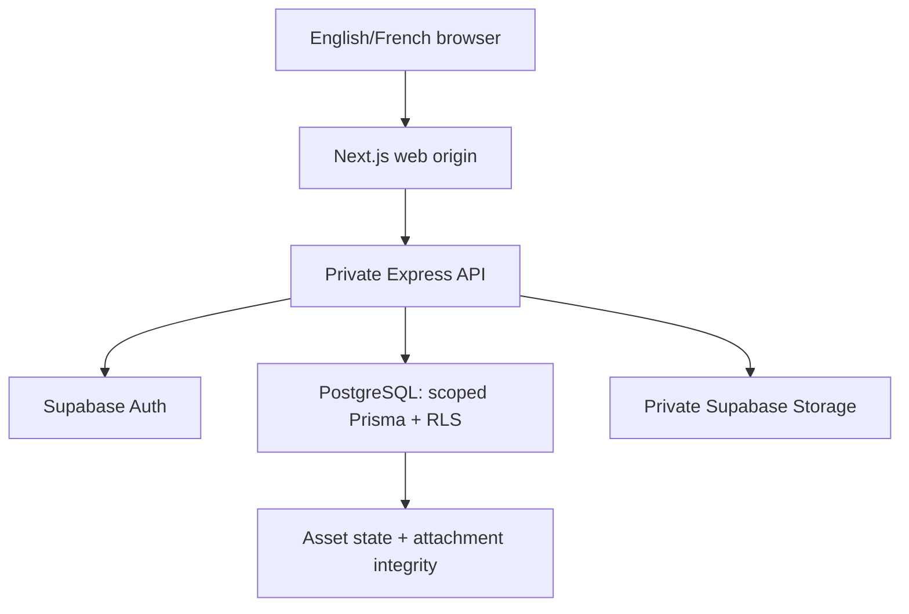

# Current architecture

The application has one web origin. Next.js serves the interface and forwards `/api/v1/*` to the private Express API. Browsers do not query application tables through Supabase's Data API. Express uses Supabase Auth to verify identity, then reloads application roles and active seller relationships from PostgreSQL. Every Prisma query runs with transaction-local actor context on a non-owner runtime connection.

## Boundaries and ownership

A `user` is an application account linked by a unique UUID to `auth.users`. Existing CUID identifiers remain intact. Users start with `USER`; client-submitted roles and editable Auth metadata cannot grant authority. An approved `property_developer` is the seller/agent business identity, not a software developer. The same relationship owns listings, images, appointments and notifications. A seller application creates a pending profile; administrator activation updates its approval metadata and the user's role in a transaction.

Properties retain stable slugs, location FKs, prices, measurements, lifecycle status and seller ownership in a language-neutral core. Existing identity, favorites, analytics, appointments and media references are retained. Unsupported features such as payments, subscriptions, messaging, a GIS service or a translation vendor have not been added.

Canonical city/district IDs replace frontend-only city lists. Composite district/city and appointment/property/seller FKs prevent otherwise valid IDs from being combined incorrectly. SQL CHECK constraints enforce bounds, status/period/currency rules and report targets; optimistic versions prevent lost listing edits. See [SCHEMA.md](SCHEMA.md) for retained legacy fields and additional SQL guarantees.

## Bilingual design

Static interface text belongs in `frontend/public/locales/{en,fr}/`: navigation, form labels, validations, notifications, errors, accessibility controls and page metadata. Dynamic domain notifications persist a stable event type and optional template key/parameters; the API renders supported templates in the requested language. Historical free text is retained without inventing translations.

Property titles/descriptions, feature names and seller biographies/specializations use related translation tables. Each has an entity/language composite key, an FK to `language`, and an FK to its entity. `property_translation.is_published` separates unfinished content from public content. Property title and description resolve together from one translation, avoiding an unlabeled mixture of two languages. Business names, prices, identifiers, coordinates, proper place names, phone numbers and dates remain neutral. No location-description table is added because the application does not currently manage localized location descriptions.

Separate `title_en/title_fr` columns would be simpler for a fixed pair of languages but require structural changes for every new language and multiply sparse fields. JSON translations would complicate FK, uniqueness and publication checks. Dedicated tables fit the existing exact-language editor and permit additional languages by configuration. The core data is not duplicated.

API clients explicitly send `lang=en` or `lang=fr`. Omitted language uses `app_settings.default_language_code` (French); unsupported or inactive codes return `400 UNSUPPORTED_LANGUAGE`. Resolution is **requested → configurable fallback → verified source language**, considering only published property translations. Unclassified legacy text is preserved for reviewed curation. The public catalogue requires explicit source language, currency and published translation metadata; unclassified legacy rows are not silently published or labeled English. Localization metadata can use `contentLanguage: null` when the language cannot be established. `app_settings.fallback_language_code` is configurable separately from the interface preference.

The browser preference cookie, i18n provider, server catalogue reads, metadata and React Query keys use the same selected language. Changing language invalidates/refetches relevant data. Editors fetch the exact requested locale and require confirmation before discarding unsaved edits; fallback text is not silently saved as a new translation.

Adding another language requires active `language` configuration, curated content translations, frontend dictionaries/formatting, language-selector support and tests. It does not require another set of content columns.

## Prices, time and media

`price` is a PostgreSQL decimal and the API exposes `priceDecimal` alongside the existing numeric DTO for compatibility. `currencyCode` and `rentPeriod` are explicit; new Burkina listings use XOF. Currency formatting and date display happen at the presentation boundary. The interface preserves fractional precision rather than silently rounding monetary values. Mixed sales and rentals do not share a misleading unlabeled average. Unknown historical currency/period values require reviewed curation; migrations never convert amounts or guess their currency.

New uploads are decoded and re-encoded by Sharp as WebP, checked for file size/dimensions and stored privately under the verified Auth UUID. `storage_asset` records track `UPLOADING → AVAILABLE → DELETING → DELETED`. A composite FK requires every attached new image to reference an `AVAILABLE` asset. That FK blocks deletion even when another reference is hidden by RLS. Failed external deletion retains a non-attachable tombstone and can be retried idempotently. Legacy Cloudinary media stays referenced and unchanged. Signed URLs are short lived and are not cached by the Next image optimizer.

Removing a photo from an unsaved form only removes the form reference. There is no automatic orphan deletion. A reviewed retention job is still needed for old, unattached uploads; it must use the lifecycle rules and avoid racing a save.

## Performance and reliability

Public catalogues, seller lists, notifications and buyer viewings are SQL-paginated and bounded. Dashboard previews use small fixed limits; analytics aggregate in SQL with bounded trend windows. Indexes reflect owner/date/status, active catalogue, favorite and appointment query paths. Slugs, feature codes and filter IDs are stable. No speculative cache or partitioning layer has been introduced.

The API validates query shapes and request bodies, rejects unrecognized ownership/authority fields, parameterizes SQL, performs multi-row changes atomically and returns stable error codes. Auth refresh is shared between bootstrap and expired requests. A session revision rejects stale refresh responses after logout/new login; mutations are not replayed under a different account. Private query state is cleared on account or authority changes. Outages are surfaced as retryable failures rather than empty catalogues, false 404s or expired-session claims.

The runtime role can set the transaction-local actor variables because the API is a trusted boundary. A stolen database runtime credential or compromised API could forge this context; RLS is defense in depth for validated application operations, not a substitute for protecting the trusted server and database credentials.

## Delivery boundary

Version-controlled migrations support fresh disposable databases and the observed existing schema. Existing-production deployment fails closed when audited migration history is unavailable. CI validates isolated schemas and browsers; deployment remains a separate manual, protected operation. Recovery, managed-provider behavior and operator provisioning must pass staging gates before production. See [DEPLOYMENT.md](DEPLOYMENT.md).
